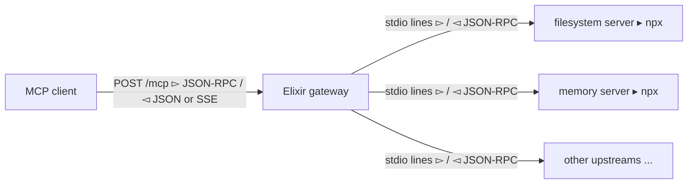

# MCP Gateway (Elixir)

A reverse proxy and multiplexer for the Model Context Protocol. It exposes one
Streamable HTTP endpoint to MCP clients (Claude Desktop, Cursor, and others)
and aggregates tools from multiple upstream stdio MCP servers.



The gateway performs the MCP handshake with every upstream at boot, caches
each server's tool list, and namespaces the names as `<server>__<tool>`.
Requests that arrive during a cold start (for example, `npx -y ...` downloads)
are queued, not dropped.

## Requirements

- Elixir 1.16 or newer (OTP 26+).
- Node.js, if you use `npx`-based upstreams.

## Build and run

```bash
mix deps.get
mix test
mix run --no-halt
```

## Simple example

`examples/simple_example.sh` compiles every environment, builds the release,
boots it with one stdio upstream, and asserts the whole path: handshake,
session, `tools/list`, `tools/call`, SSE framing, notifications, and session
termination. Every step must pass, or the script exits non-zero.

```bash
bash examples/simple_example.sh
```

Configure upstreams with the `MCP_UPSTREAMS` environment variable (a JSON
array) or in `config/config.exs`:

```bash
MCP_UPSTREAMS='[
  {"name": "filesystem", "command": "npx", "args": ["-y", "@modelcontextprotocol/server-filesystem", "/tmp"]},
  {"name": "memory", "command": "npx", "args": ["-y", "@modelcontextprotocol/server-memory"]}
]' PORT=4000 mix run --no-halt
```

`name` is the namespace prefix. `command` must be an executable on `PATH`.

## Client configuration

Point any Streamable HTTP MCP client at the gateway:

```json
{
  "mcpServers": {
    "gateway": {
      "url": "http://localhost:4000/mcp"
    }
  }
}
```

## Endpoints

| Route        | Method   | Purpose                                        |
| ------------ | -------- | ---------------------------------------------- |
| `/mcp`       | POST     | JSON-RPC 2.0. Replies JSON, or SSE if accepted |
| `/mcp`       | DELETE   | Terminate the session (needs `Mcp-Session-Id`) |
| `/mcp`       | GET      | 405. The gateway has no server-initiated stream |
| `/health`    | GET      | Liveness probe                                 |

## Curl walkthrough

```bash
URL=http://localhost:4000/mcp

# 1. initialize and capture the session id
session=$(curl -s -D - -o /dev/null -X POST "$URL" \
  -H 'Content-Type: application/json' \
  -H 'Accept: application/json' \
  -d '{"jsonrpc":"2.0","id":1,"method":"initialize","params":{"protocolVersion":"2025-03-26","capabilities":{},"clientInfo":{"name":"curl","version":"0"}}}' \
  | grep -i mcp-session-id | tr -d '\r' | awk '{print $2}')

# 2. list all aggregated, namespaced tools
curl -s -X POST "$URL" -H 'Content-Type: application/json' -H 'Accept: application/json' \
  -H "Mcp-Session-Id: $session" \
  -d '{"jsonrpc":"2.0","id":2,"method":"tools/list"}' | jq

# 3. call a tool on a specific upstream server
curl -s -X POST "$URL" -H 'Content-Type: application/json' -H 'Accept: application/json' \
  -H "Mcp-Session-Id: $session" \
  -d '{"jsonrpc":"2.0","id":3,"method":"tools/call","params":{"name":"filesystem__read_file","arguments":{"path":"/tmp/hello.txt"}}}' | jq

# 4. end the session
curl -s -X DELETE "$URL" -H "Mcp-Session-Id: $session" -o /dev/null -w '%{http_code}\n'
```

## Modules

| File                             | Role                                                              |
| -------------------------------- | ----------------------------------------------------------------- |
| `lib/mcp_gateway/application.ex` | Supervision tree. Starts Bandit and configured upstreams.          |
| `lib/mcp_gateway/router.ex`      | Streamable HTTP endpoint. Session handling and RPC multiplexing.   |
| `lib/mcp_gateway/upstream.ex`    | GenServer per stdio server. Handshake, tool cache, call proxying.  |
| `lib/mcp_gateway/sessions.ex`    | `Mcp-Session-Id` registry (in-memory).                             |
| `priv/fake_mcp_server.exs`       | Fake upstream used by the test suite.                              |

## Known limitations

- Upstream transport is stdio only. Remote HTTP/SSE upstreams are not proxied.
- Sessions live in one node's memory. They do not survive a restart and are
  not shared across nodes.
- No authentication, rate limiting, or per-tool ACLs. Put the gateway behind
  a reverse proxy or add a Plug if you expose it.
- Server-initiated messages (SSE GET stream, sampling, roots) are rejected
  upstream and not offered downstream.
